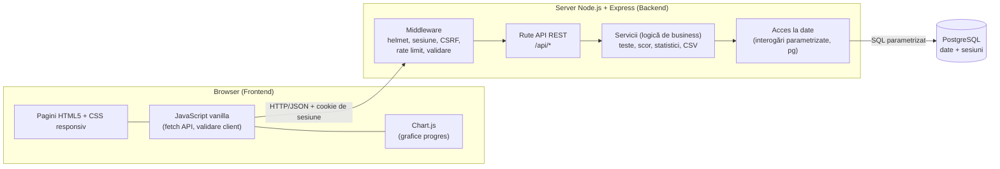
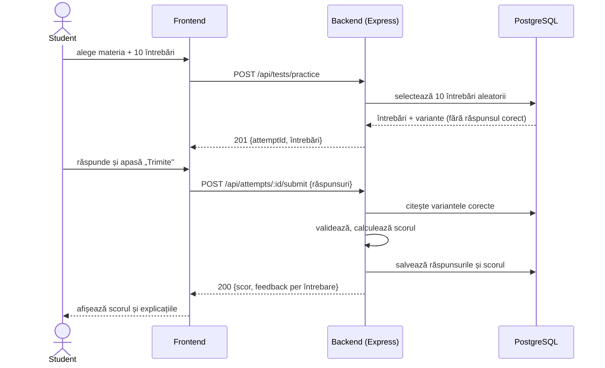
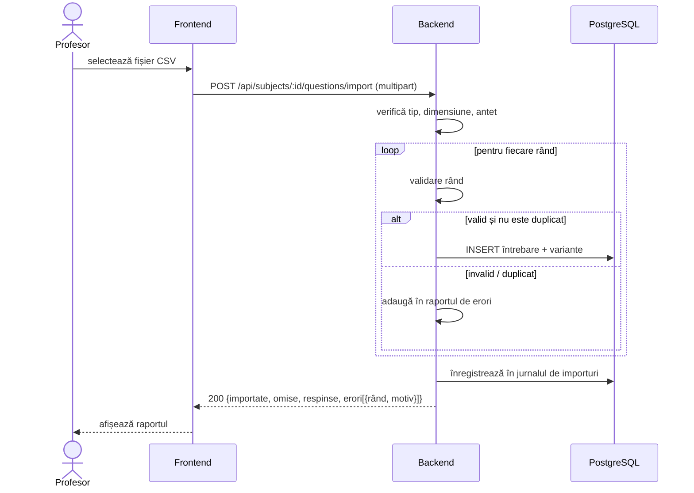

# Arhitectura aplicației – StudyHub

## 1. Vedere de ansamblu

StudyHub este o aplicație web cu **arhitectură pe trei straturi** (client – server – bază de date). Frontend-ul este un set de pagini HTML/CSS/JS servite static de Express; comunicarea cu backend-ul se face prin **API REST (JSON)** peste HTTP. Nu se folosesc servicii externe.



## 2. Componente

### 2.1 Frontend (responsabil: Student 2)
- **Pagini:** login/înregistrare, dashboard student, test nou, rezolvare test, rezultat, progres, bancă de întrebări, import/export CSV, administrare.
- **JavaScript vanilla** organizat în module ES (`api.js` pentru apeluri `fetch`, câte un modul per pagină).
- **Chart.js** pentru graficul evoluției scorurilor și pentru procentele pe capitole.
- **Accesibilitate:** HTML semantic, etichete `<label>`, navigare cu tastatura, `aria-live` pentru mesaje.
- Datele primite de la server sunt inserate în pagină cu `textContent` (nu `innerHTML`), pentru prevenirea XSS.

### 2.2 Backend (responsabil: Student 1)
Structură pe straturi:

| Strat | Rol | Exemplu |
|-------|-----|---------|
| **Middleware** | securitate și funcții transversale | `helmet`, `express-session`, protecție CSRF, `express-rate-limit`, `requireAuth`, `requireRole('profesor')` |
| **Rute** | definesc endpoint-urile, validează intrarea | `routes/questions.js` |
| **Servicii** | logica de business | `testService` (selecție aleatorie, scor), `statsService`, `csvService` |
| **Acces la date** | interogări SQL parametrizate | `db/questions.js` |
| **Gestionarea erorilor** | handler central: cod HTTP + `{error, details}` | `middleware/errorHandler.js` |

### 2.3 Persistență
**PostgreSQL** stochează utilizatorii, materiile, întrebările, testele, rezolvările și sesiunile (tabela `session`, prin `connect-pg-simple`). Schema este în [data-model.md](data-model.md); se creează cu un script SQL (`db/schema.sql`) și date de demonstrație (`db/seed.sql`).

## 3. Structura planificată a proiectului

```
studyhub/
├── README.md
├── docs/
├── src/
│   ├── app.js                 # configurare Express
│   ├── server.js              # pornire server
│   ├── config/                # variabile de mediu
│   ├── middleware/            # auth, roluri, erori, validare
│   ├── routes/                # auth, users, subjects, questions, tests, stats, csv, admin
│   ├── services/              # logica de business
│   └── db/                    # conexiune, interogări, schema.sql, seed.sql
├── public/                    # frontend (HTML, CSS, JS)
│   ├── css/
│   ├── js/
│   └── *.html
├── tests/                     # Jest + Supertest
├── .env.example
└── package.json
```

## 4. Comunicare și fluxuri

### 4.1 Autentificare și sesiune
1. Clientul trimite `POST /api/auth/login` cu email și parolă.
2. Serverul caută utilizatorul, compară parola cu hash-ul bcrypt și creează sesiunea în PostgreSQL.
3. Browserul primește un cookie `HttpOnly`, `SameSite=Lax` (și `Secure` în producție) și îl trimite automat la fiecare cerere.
4. Middleware-ul `requireAuth` citește sesiunea; `requireRole` verifică rolul.

### 4.2 Flux end-to-end: rezolvarea unui test



> Observație de securitate: răspunsul corect **nu** este trimis clientului în timpul testului; este returnat abia după trimitere.

### 4.3 Flux import CSV



## 5. Securitate (măsuri planificate)

| Risc | Măsură |
|------|--------|
| Parole expuse | bcrypt (cost ≥ 12), parole niciodată logate sau returnate |
| Acces neautorizat | autentificare pe sesiune, verificare de rol pe server, verificare de proprietate (profesorul modifică doar întrebările proprii; studentul vede doar rezolvările proprii) |
| SQL injection | doar interogări parametrizate |
| XSS | `textContent` pe client, validare și escapare pe server, antete `helmet` (CSP) |
| CSRF | cookie `SameSite` și token CSRF pe cereri `POST/PUT/DELETE` |
| Forță brută | `express-rate-limit` pe `/api/auth/*` |
| Încărcare de fișiere | limită de 2 MB, doar `.csv`, fișierul se procesează în memorie și nu se păstrează |
| Secrete | `.env` în `.gitignore`; `.env.example` fără valori reale |

## 6. Gestionarea erorilor

Format unitar: `{ "error": "mesaj scurt", "details": [{"field": "...", "message": "..."}] }`.

| Cod | Situație |
|-----|----------|
| 400 | date invalide |
| 401 | neautentificat |
| 403 | rol sau proprietate insuficientă |
| 404 | resursă inexistentă |
| 409 | conflict (email existent, test deja trimis) |
| 413 | fișier prea mare |
| 429 | prea multe încercări |
| 500 | eroare internă (mesaj generic, detalii doar în log) |

## 7. Deployment (opțional)
Rulare locală cu `npm start` și PostgreSQL local (sau Docker Compose). Opțional: GitHub Actions pentru rularea testelor și deployment într-un serviciu gratuit.
