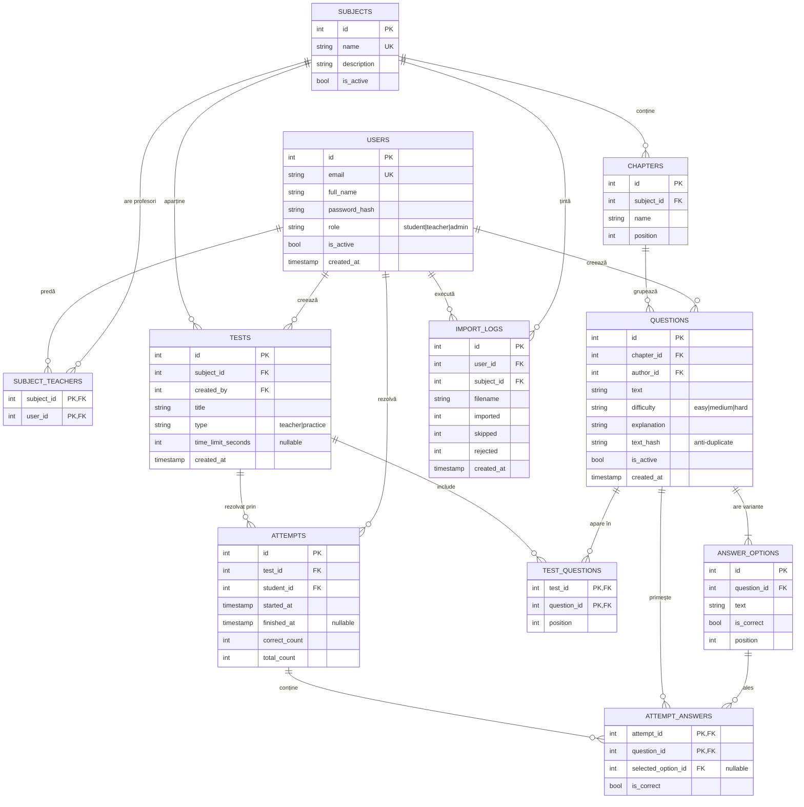

# Model de date și API – StudyHub

## 1. Diagrama entitate–relație



## 2. Entități – descriere și reguli

| Entitate | Descriere | Reguli principale |
|----------|-----------|-------------------|
| `users` | conturi | email unic; `password_hash` bcrypt; rol ∈ {student, teacher, admin}; dezactivare în loc de ștergere |
| `subjects` | materii | nume unic |
| `subject_teachers` | asociere profesor–materie (M:N) | un profesor lucrează doar pe materiile asociate |
| `chapters` | capitole ale unei materii | nume unic în cadrul materiei |
| `questions` | întrebări din bancă | aparțin unui capitol; `text_hash` (hash al textului normalizat + capitol) previne duplicatele; ștergere logică (`is_active = false`) ca să nu se piardă istoricul |
| `answer_options` | variante de răspuns | 2–6 per întrebare; exact una cu `is_correct = true` |
| `tests` | definiții de test | `teacher` = set fix creat de profesor; `practice` = generat pentru un student |
| `test_questions` | întrebările unui test | ordonate prin `position` |
| `attempts` | o rezolvare de către un student | scorul = `correct_count / total_count`; o rezolvare se trimite o singură dată |
| `attempt_answers` | răspunsurile date | `selected_option_id` poate fi null (fără răspuns, se numără greșit) |
| `import_logs` | jurnal import CSV | numere agregate, fără conținutul fișierului |

**Statistici (calculate prin interogări SQL, nu stocate):**
- *Progres pe capitol:* procentul de răspunsuri corecte din `attempt_answers` grupate după capitolul întrebării, pentru un student.
- *Întrebări dificile:* rata de greșeli = răspunsuri greșite / răspunsuri totale, per întrebare (doar pentru întrebări cu cel puțin 5 răspunsuri).

**Indexuri propuse:** `questions(chapter_id)`, `questions(text_hash)` unic, `attempts(student_id, finished_at)`, `attempt_answers(question_id)`.

## 3. Formatul fișierului CSV

- Codare UTF-8, separator virgulă, câmpurile cu virgule sau ghilimele sunt între ghilimele (RFC 4180), antet obligatoriu.
- Maximum 2 MB.

```csv
chapter,text,difficulty,option_1,option_2,option_3,option_4,correct,explanation
"SQL – JOIN-uri","Ce returnează un INNER JOIN?",medium,"Toate rândurile din ambele tabele","Doar rândurile cu potrivire în ambele tabele","Doar rândurile din tabelul stâng","Produsul cartezian",2,"INNER JOIN păstrează doar rândurile care se potrivesc."
```

| Coloană | Obligatorie | Reguli |
|---------|-------------|--------|
| `chapter` | da | text 1–100 caractere; dacă nu există, se creează (setare la import) |
| `text` | da | 5–1000 caractere |
| `difficulty` | da | `easy`, `medium` sau `hard` |
| `option_1` … `option_6` | minimum 2 | text 1–300 caractere; fără goluri între variante |
| `correct` | da | număr de la 1 la numărul variantelor completate |
| `explanation` | nu | maximum 1000 caractere |

**Erori raportate** (cu numărul rândului): antet invalid, câmp obligatoriu lipsă, dificultate invalidă, mai puțin de 2 variante, `correct` în afara intervalului, text prea lung, duplicat (omis).

## 4. API REST (propus)

Prefix `/api`; toate răspunsurile sunt JSON, cu excepția exportului CSV. Rolurile: **S** = student, **P** = profesor, **A** = administrator. Cererile care modifică date cer token CSRF.

### 4.1 Autentificare
| Metodă | Endpoint | Rol | Descriere |
|--------|----------|-----|-----------|
| POST | `/auth/register` | public | creează cont de student |
| POST | `/auth/login` | public | autentificare, creează sesiunea |
| POST | `/auth/logout` | autentificat | încheie sesiunea |
| GET | `/auth/me` | autentificat | utilizatorul curent și rolul |
| PUT | `/auth/password` | autentificat | schimbare parolă |

### 4.2 Materii și capitole
| Metodă | Endpoint | Rol | Descriere |
|--------|----------|-----|-----------|
| GET | `/subjects` | autentificat | lista materiilor active |
| POST | `/subjects` | A | creează materie |
| PUT | `/subjects/:id` | A | editează materie |
| DELETE | `/subjects/:id` | A | dezactivează materie |
| PUT | `/subjects/:id/teachers` | A | setează profesorii asociați |
| GET | `/subjects/:id/chapters` | autentificat | capitolele materiei |
| POST | `/subjects/:id/chapters` | P, A | adaugă capitol |
| PUT / DELETE | `/chapters/:id` | P, A | editează / șterge capitol |

### 4.3 Întrebări
| Metodă | Endpoint | Rol | Descriere |
|--------|----------|-----|-----------|
| GET | `/subjects/:id/questions?chapter=&difficulty=&page=` | P, A | listare cu filtre și paginare |
| POST | `/subjects/:id/questions` | P, A | creează întrebare cu variante |
| GET | `/questions/:id` | P, A | detalii întrebare |
| PUT | `/questions/:id` | P (proprii), A | editează |
| DELETE | `/questions/:id` | P (proprii), A | șterge (logic) |

### 4.4 Teste și rezolvări
| Metodă | Endpoint | Rol | Descriere |
|--------|----------|-----|-----------|
| GET | `/tests?subject=` | S, P | teste disponibile |
| POST | `/tests` | P | creează test fix |
| PUT / DELETE | `/tests/:id` | P (proprii), A | editează / șterge |
| POST | `/tests/practice` | S | generează test de exersare `{subjectId, chapterIds[], count}` |
| POST | `/tests/:id/attempts` | S | începe o rezolvare |
| POST | `/attempts/:id/submit` | S | trimite răspunsurile; returnează scor și feedback |
| GET | `/attempts/:id` | S (proprii) | rezultat detaliat |

### 4.5 Progres și statistici
| Metodă | Endpoint | Rol | Descriere |
|--------|----------|-----|-----------|
| GET | `/me/attempts?subject=` | S | istoric rezolvări |
| GET | `/me/progress?subject=` | S | scoruri în timp și procent pe capitol |
| GET | `/subjects/:id/stats/hard-questions` | P, A | întrebări cu rata mare de greșeli (opțional) |

### 4.6 CSV
| Metodă | Endpoint | Rol | Descriere |
|--------|----------|-----|-----------|
| POST | `/subjects/:id/questions/import` | P, A | import CSV (multipart); returnează raportul |
| GET | `/subjects/:id/questions/export` | P, A | export CSV |
| GET | `/admin/import-logs` | A | jurnal importuri |

### 4.7 Administrare
| Metodă | Endpoint | Rol | Descriere |
|--------|----------|-----|-----------|
| GET | `/admin/users?search=&page=` | A | lista utilizatorilor |
| POST | `/admin/users` | A | creează utilizator |
| PUT | `/admin/users/:id` | A | schimbă rol / activare |

### 4.8 Exemple de contract

`POST /api/subjects/3/questions`
```json
{
  "chapterId": 12,
  "text": "Ce returnează un INNER JOIN?",
  "difficulty": "medium",
  "explanation": "Păstrează doar rândurile care se potrivesc.",
  "options": [
    {"text": "Produsul cartezian", "isCorrect": false},
    {"text": "Doar rândurile cu potrivire în ambele tabele", "isCorrect": true}
  ]
}
```
Răspuns `201`: `{ "id": 245 }`. Răspuns `400`: `{ "error": "Date invalide", "details": [{"field": "options", "message": "Exact o variantă trebuie să fie corectă"}] }`.

`POST /api/attempts/57/submit`
```json
{ "answers": [ {"questionId": 245, "optionId": 981}, {"questionId": 246, "optionId": null} ] }
```
Răspuns `200`:
```json
{
  "correct": 7, "total": 10, "percent": 70,
  "feedback": [
    {"questionId": 245, "isCorrect": true, "selectedOptionId": 981, "correctOptionId": 981, "explanation": "..."}
  ]
}
```
