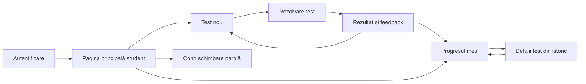
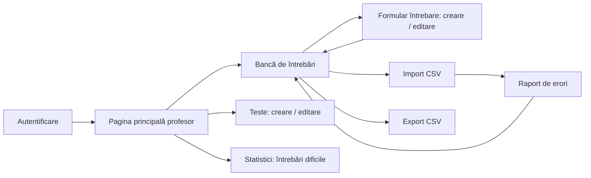
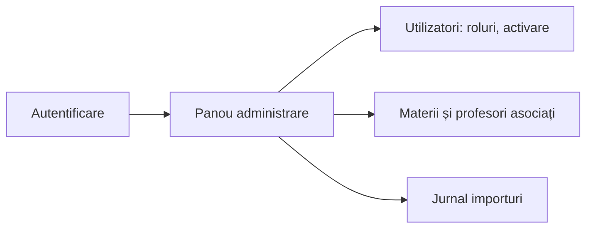

# Wireframe-uri și fluxuri de navigare – StudyHub

Wireframe-urile sunt schițe low-fidelity ale ecranelor principale (fișiere SVG, deschise direct în browser sau în GitHub). Layout-ul este gândit **responsive**: pe ecrane înguste (≥ 360 px) meniul devine vertical, iar coloanele se așază una sub alta.

## 1. Ecranele principale

| # | Ecran | Rol | Scenariu | Fișier |
|---|-------|-----|----------|--------|
| 1 | Autentificare / Înregistrare | toți | UC-05 (acces) | [01-login.svg](01-login.svg) |
| 2 | Progresul meu | student | UC-03 | [02-student-progres.svg](02-student-progres.svg) |
| 3 | Test nou | student | UC-02 | [03-test-nou.svg](03-test-nou.svg) |
| 4 | Rezolvare test | student | UC-02 | [04-rezolvare-test.svg](04-rezolvare-test.svg) |
| 5 | Rezultat și feedback | student | UC-02 | [05-rezultat.svg](05-rezultat.svg) |
| 6 | Bancă de întrebări | profesor | UC-01 | [06-banca-intrebari.svg](06-banca-intrebari.svg) |
| 7 | Import CSV și raport de erori | profesor | UC-04 | [07-import-csv.svg](07-import-csv.svg) |
| 8 | Administrare utilizatori | administrator | UC-05 | [08-admin-utilizatori.svg](08-admin-utilizatori.svg) |

## 2. Fluxuri de navigare

### Student

### Profesor

### Administrator

## 3. Reguli de interfață (accesibilitate)

- Fiecare câmp de formular are `<label>` asociat; erorile apar lângă câmp și sunt anunțate cu `aria-live`.
- Toate acțiunile se pot face de la tastatură (ordine logică la `Tab`, focus vizibil).
- Starea nu este indicată doar prin culoare: răspunsurile corecte/greșite au și simbol (✔ / ✘) și text.
- Contrast ridicat pentru text și butoane; dimensiuni de atingere suficiente pe mobil.
- Acțiunile distructive (ștergere, dezactivare) cer confirmare.
